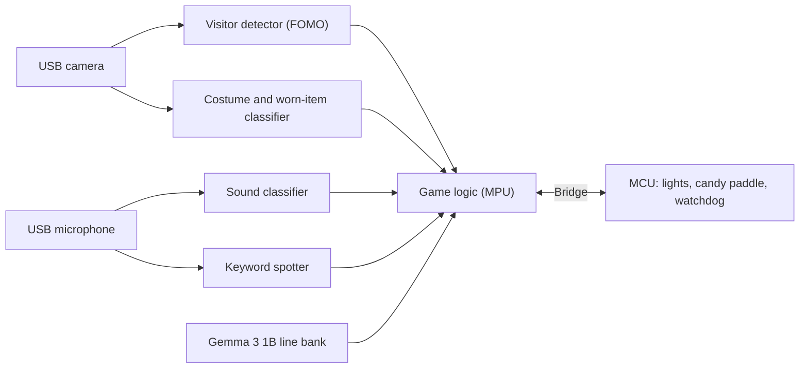

# Feed the Gargoyle

*Scream loud enough and it pays up.*

Feed the Gargoyle is an interactive candy dispenser that runs entirely offline on an Arduino UNO Q. A stone-faced gargoyle guards a bowl of candy. Step up and it sets a challenge: scream, howl or growl at it, or shout the answer to a riddle. A light bar along its spine fills as your sound matches. Fill it, or answer correctly, and one candy drops from its mouth. Fail and it answers with a line written ahead of time, including a reference to your costume when it can recognise one.

The project is also a worked example of a gated model cascade on the UNO Q. Small Edge Impulse models decide when and what to run, an open-weight language model writes the dialogue, and the STM32 side keeps the hardware safe if the Linux side stalls.

## Status

Build complete and running on the bench. The design is documented under `docs/`. Working: the four Edge Impulse models load and run on the UNO Q through App Lab bricks, the LED strip, paddle servo, IR break-beam and mist switch work from the real sketch, and the 164-line voice bank is rendered. More model tuning is needed and is in progress: props and costume score below 70% on held-out images (props 55.9%, costume 64.4%, Edge Impulse Studio, float32) and are low-confidence extras for now, and sound uses a loudness gate instead of a classifier. Still to do: a full run with strangers at the door and the enclosure. Measurements are in [docs/benchmarks/](docs/benchmarks/). See the [roadmap](docs/roadmap.md).

## How it plays

1. A visitor walks up. The gargoyle wakes and its eyes light.
2. It picks a challenge: a scream, a howl or a growl, or a riddle with a few answers to shout.
3. For a sound challenge, the spine bar fills as the sound matches the request. For a riddle, the right answer counts.
4. Win: one wrapped candy slides down its tongue. Fail: it plays a line from its pre-written bank, using the visitor's costume when the camera is confident about it.
5. After a short cooldown it goes back to sleep.

## System overview

- **MPU (Linux):** runs the models and the game logic. Cheap detectors gate the expensive work.
- **MCU (STM32U585):** drives the spine plates, eye boards and candy paddle in real time, confirms each drop with a break-beam sensor, and moves everything to a safe state if the MPU stops responding.
- **Language model:** Gemma 3 1B writes the line bank while the gargoyle is idle. Lines are validated and pre-rendered to speech, so nothing waits on the model during play.

Details are in [docs/architecture.md](docs/architecture.md).

## Models

| Model | Task | Runs on | Status |
|---|---|---|---|
| Visitor detector | FOMO person detection; wakes the system | MPU | Runs on the board (int8); Studio F1 0.69 |
| Sound classifier | Scream, howl, growl, other | MPU | Runs on the board (float32); Studio 45.6 percent, not good enough yet |
| Keyword spotter | Shouted riddle answers | MPU | Runs on the board (float32); Studio about 80 percent |
| Costume classifier | Worn items and a few costumes; speaks only when confident | MPU | Runs on the board (float32); 39.6 percent top-1 on 96 images, weak |
| Gemma 3 1B | Writes the line bank offline, on the board | MPU | Bank rendered; not run during play |

## Hardware

Arduino UNO Q (4 GB), USB camera and microphone, WS2812B spine plates and 7-pixel eye boards, a servo paddle that releases one sweet at a time from a tilted tube, with an IR drop sensor, inside a gargoyle crouched on a stone-block plinth. The full list is in [docs/bill-of-materials.md](docs/bill-of-materials.md).

## Repository layout

| Path | Contents |
|---|---|
| `app/` | The App Lab application: `python/` for the MPU, `sketch/` for the MCU |
| `models/` | Notes and checksums for the Edge Impulse model builds (binaries are not tracked) |
| `data/` | Dataset documentation (raw recordings are not tracked) |
| `hardware/` | CAD, enclosure and wiring files |
| `scripts/` | Data capture, evaluation and deployment helpers |
| `tests/` | Automated tests |
| `docs/` | Architecture, bill of materials, data and evaluation plans, roadmap, decisions, references |

## Documentation

- [Architecture](docs/architecture.md)
- [Bill of materials](docs/bill-of-materials.md)
- [Data collection](docs/data-collection.md)
- [Evaluation plan](docs/evaluation-plan.md)
- [Benchmarks](docs/benchmarks/)
- [Roadmap](docs/roadmap.md)
- [Decision log](docs/decisions.md)
- [References and credits](docs/references.md)

## Privacy and safety

- Camera frames are processed in memory and discarded. No audio or images are stored during play, and the device makes no network calls at runtime.
- The candy path handles only individually wrapped sweets. Printed parts never touch unwrapped food.
- The paddle, its servo and the throat are out of reach of hands, and the MCU watchdog returns them to a safe state if the MPU stops responding.
- Spoken lines never refer to a person's face or body.

## Licence

MIT. See [LICENSE](LICENSE).
