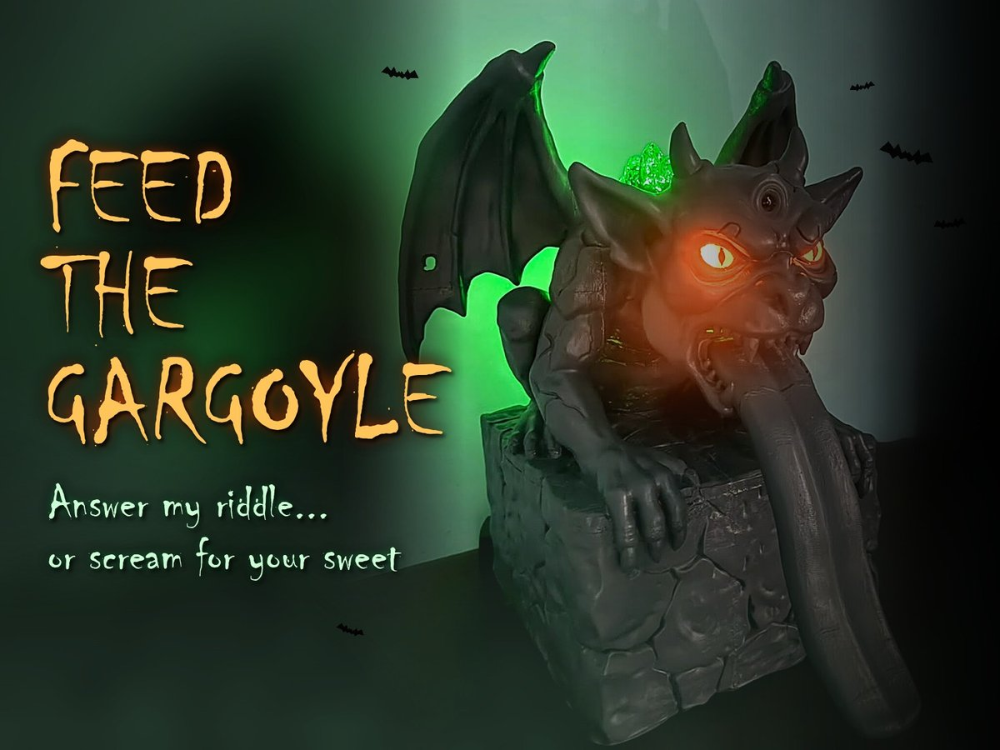
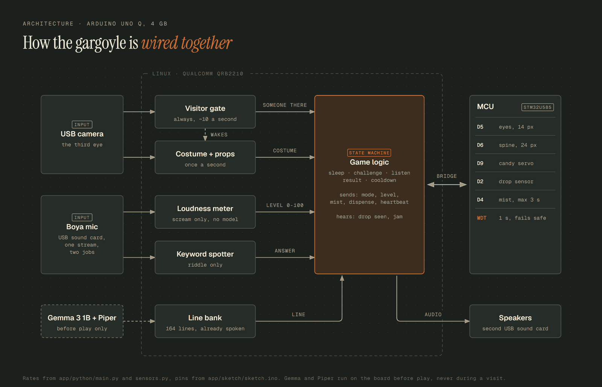
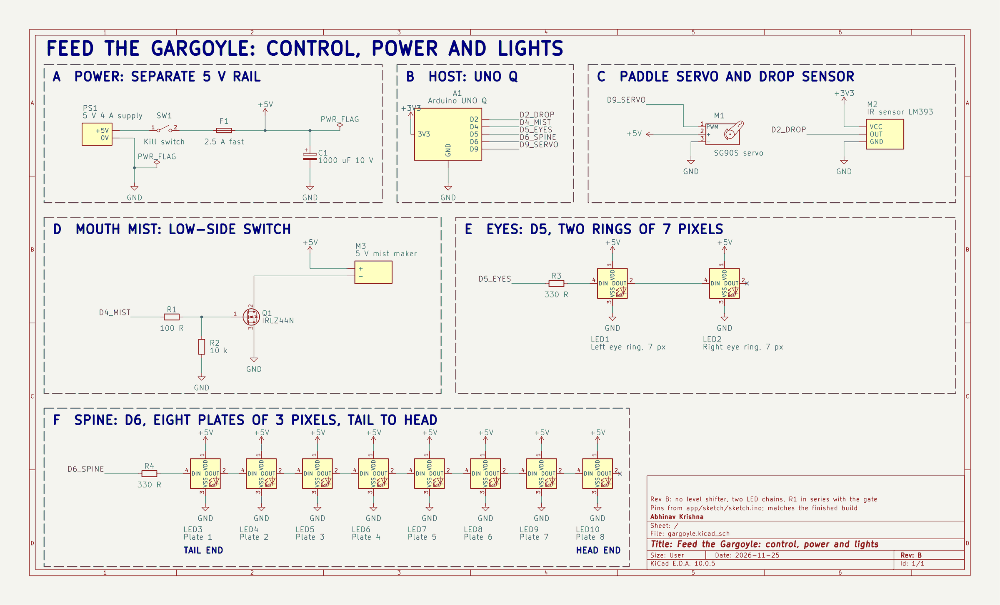

# Feed the Gargoyle

*Scream loud enough and it pays up.*

Feed the Gargoyle is an interactive candy dispenser that runs entirely offline on an Arduino UNO Q. A stone-faced gargoyle guards a bowl of candy. Step up and it sets a challenge: scream at it, or shout the answer to a riddle. During a scream the light bar along its spine is a loudness meter; during a riddle it counts down. Scream the bar to the top, or answer correctly, and one candy drops from its mouth. Fail and it answers with a line written ahead of time. If it recognises your costume, it says so when you walk up.

The project is also a worked example of a gated model cascade on the UNO Q. Small Edge Impulse models decide when and what to run, an open-weight language model drafts the dialogue offline, and the STM32 side keeps the hardware safe if the Linux side stalls.

## Status

Built and playing. The statue is printed, stone-coated and wired, and every outcome has been played on the finished body: right answer, wrong answer, timer out, a winning scream and a scream too quiet. All four Edge Impulse models are final and run on the UNO Q (visitor and keyword spotter through App Lab bricks, costume and props as Edge Impulse runners). The spine meter, eyes, paddle servo, IR drop sensor and mist switch run from the real sketch, and the 164-line voice bank is rendered on the board. The scream is judged by a loudness meter, not a model. The pre-Halloween checks are done: a couple of visits in a row at the door, an hour of empty doorway, a fault-injection check of the MCU safe state and a soak test of two hours. Measurements are in [docs/benchmarks/](docs/benchmarks/). See the [roadmap](docs/roadmap.md).

## How it plays

1. A visitor walks up. The gargoyle wakes, its eyes light, and it greets them, naming the costume when the camera is confident about it.
2. It picks a challenge: a scream, or a riddle with a few answers to shout.
3. Scream: the spine is a loudness meter, and the scream has to reach the top of the spine. Riddle: the spine counts down, and the keyword spotter has to hear the right answer before it runs out.
4. Win: one wrapped candy slides down its tongue. Fail: it plays a line from its pre-written bank and gloats with a laugh or a growl.
5. After a short cooldown it goes back to sleep.

## System overview

- **MPU (Linux):** runs the models and the game logic. Cheap detectors gate the expensive work.
- **MCU (STM32U585):** drives the spine plates, eye boards and candy paddle in real time, confirms each drop with a break-beam sensor, and moves everything to a safe state if the MPU stops responding.
- **Language model:** Gemma 3 1B drafted lines for the bank ahead of time, on the board; the kept lines were checked and edited by hand, then pre-rendered to speech, so nothing waits on the model during play.

Details are in [docs/architecture.md](docs/architecture.md).

## Models

| Model | Task | Runs on | Status |
|---|---|---|---|
| Visitor classifier | Visitor or empty scene (MobileNetV2 0.5, 160x160); wakes the system after about 1.2 s (a score of 0.6 or more on 10 game loop passes in a row) | MPU | Final. Runs on the board (float32); Studio 91.8 percent on 475 held-out COCO test images |
| Loudness meter | Scream level: 0.2 s RMS of the camera mic, mapped to 0 to 100 on the spine; win at 94 on 2 readings in a row | MPU | No model (D28). It replaced a sound classifier that scored 45.6 percent in Studio |
| Keyword spotter | Six riddle answers plus noise and unknown (MFE, Studio's keyword transfer learning block, MobileNetV2 0.35) | MPU | Final. 530 of 569 held-out clips (93.15 percent) with the float32 .eim on the board, the same as Studio; 34.5 ms per 1 s window (median, no app running) |
| Costume classifier | 11 costumes plus none (Edge Impulse EfficientNet B2 transfer learning, 224x224); speaks only when confident | MPU | Final. 172 of 186 held-out test images (92.5 percent, top answer, float32, in Studio); the same 172 on the board under LiteRT; 362 ms per frame (median, 2 threads, full app running). Runs as a float32 .tflite under LiteRT (D33) |
| Props detector | Crown, eye mask, glasses, hat, scarf (object detection on a head crop found with YuNet); fallback when no costume is sure | MPU | Final. Studio mAP@50 0.82 on 1,153 held-out crops (float32); 825 ms per check on the board with the app running (median of 10) |
| Gemma 3 1B | Drafted the line bank offline, on the board | MPU | Bank rendered; not run during play |

## Hardware

Arduino UNO Q (4 GB), USB camera and microphone, WS2812B spine plates and 7-pixel eye boards, a servo paddle that releases one sweet at a time from a tilted tube, with an IR drop sensor, inside a gargoyle crouched on a stone-block plinth. The full list is in [docs/bill-of-materials.md](docs/bill-of-materials.md).

The KiCad project is in [hardware/kicad/](hardware/kicad/). LEDs, servo and mist maker run from their own fused 5 V rail; the IR drop sensor runs from the UNO Q 3.3 V pin.

## Build and run

The whole thing is one Arduino App Lab app in [app/](app/): `app/python/` runs on the Linux side (models, game, voice) and `app/sketch/` on the STM32 (LEDs, paddle, drop sensor, watchdog). App Lab compiles and flashes the sketch when the app starts.

1. Wire the board as in the schematic above and the [bill of materials](docs/bill-of-materials.md). LEDs, servo and mist maker go on the separate 5 V rail.
2. Deploy the Edge Impulse models. `visitor.eim` and `keywords.eim` (Linux (AARCH64), float32) go in `/home/arduino/.arduino-bricks/ei-models/` (paths in [app/app.yaml](app/app.yaml)); `props.eim` goes in `app/python/models/`. The costume model goes in `app/python/models/` as `costume.tflite`, the float32 TensorFlow Lite file from the project dashboard's downloads (D33). See [models/](models/) for the builds and checksums.
3. Render the voice bank with [scripts/render_bank.py](scripts/render_bank.py) into `app/python/bank/`, and the laughs and growls with [scripts/sound_clips.py](scripts/sound_clips.py) into `app/python/sounds/`.
4. Create an empty `app/python/sensors.on` so the app uses the real models instead of the stub.
5. Copy `app/` to `/home/arduino/ArduinoApps/gargoyle` on the board and run `arduino-app-cli app start /home/arduino/ArduinoApps/gargoyle`.

Bench modes: an empty `app/python/dispense.on` runs 50 test dispenses instead of the game, and `app/python/bench.on` runs the Bridge latency check. More in [app/README.md](app/README.md).

## Repository layout

| Path | Contents |
|---|---|
| `app/` | The App Lab application: `python/` for the MPU, `sketch/` for the MCU |
| `models/` | Notes and checksums for the Edge Impulse model builds (binaries are not tracked) |
| `data/` | Dataset documentation (raw recordings are not tracked) |
| `hardware/` | CAD, enclosure and wiring files |
| `scripts/` | Data capture, evaluation and deployment helpers |
| `tests/` | Automated tests |
| `docs/` | Architecture, bill of materials, data and evaluation plans, roadmap, decisions, references |

## Documentation

- [Architecture](docs/architecture.md)
- [Bill of materials](docs/bill-of-materials.md)
- [Data collection](docs/data-collection.md)
- [Evaluation plan](docs/evaluation-plan.md)
- [Benchmarks](docs/benchmarks/)
- [Roadmap](docs/roadmap.md)
- [Decision log](docs/decisions.md)
- [References and credits](docs/references.md)

## Privacy and safety

- Camera frames are processed in memory and discarded. No audio or images are stored during play, and the device makes no network calls at runtime.
- The candy path handles only individually wrapped sweets. Printed parts never touch unwrapped food.
- The paddle, its servo and the throat are out of reach of hands, and the MCU watchdog returns them to a safe state if the MPU stops responding.
- Spoken lines never refer to a person's face or body.

## Licence

MIT. See [LICENSE](LICENSE).
