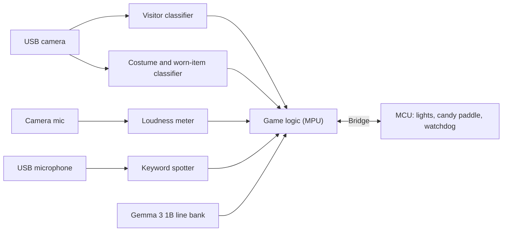

# Feed the Gargoyle

*Scream loud enough and it pays up.*

Feed the Gargoyle is an interactive candy dispenser that runs entirely offline on an Arduino UNO Q. A stone-faced gargoyle guards a bowl of candy. Step up and it sets a challenge: scream at it, or shout the answer to a riddle. During a scream the light bar along its spine is a loudness meter; during a riddle it counts down. Scream the bar to the top, or answer correctly, and one candy drops from its mouth. Fail and it answers with a line written ahead of time, including a reference to your costume when it can recognise one.

The project is also a worked example of a gated model cascade on the UNO Q. Small Edge Impulse models decide when and what to run, an open-weight language model drafts the dialogue offline, and the STM32 side keeps the hardware safe if the Linux side stalls.

## Status

Build complete and running on the bench. The design is documented under `docs/`. Working: the visitor and keyword models run on the UNO Q through App Lab bricks, the costume and props models run as Edge Impulse runners next to them, the LED strip, paddle servo, IR break-beam and mist switch work from the real sketch, and the 164-line voice bank is rendered. The visitor, keyword and costume models are final; the props model is still being improved. The scream challenge is judged by a loudness meter, not a model. Still to do: setting the meter's dB range at the fixed mic gain, a full run with strangers at the door and the enclosure. Measurements are in [docs/benchmarks/](docs/benchmarks/). See the [roadmap](docs/roadmap.md).

## How it plays

1. A visitor walks up. The gargoyle wakes and its eyes light.
2. It picks a challenge: a scream, or a riddle with a few answers to shout.
3. Scream: the spine is a loudness meter, and the scream has to reach the top of the spine. Riddle: the spine counts down, and the keyword spotter has to hear the right answer before it runs out.
4. Win: one wrapped candy slides down its tongue. Fail: it plays a line from its pre-written bank, using the visitor's costume when the camera is confident about it.
5. After a short cooldown it goes back to sleep.

## System overview

- **MPU (Linux):** runs the models and the game logic. Cheap detectors gate the expensive work.
- **MCU (STM32U585):** drives the spine plates, eye boards and candy paddle in real time, confirms each drop with a break-beam sensor, and moves everything to a safe state if the MPU stops responding.
- **Language model:** Gemma 3 1B drafted lines for the bank ahead of time, on the board; the kept lines were checked and edited by hand, then pre-rendered to speech, so nothing waits on the model during play.

Details are in [docs/architecture.md](docs/architecture.md).

## Models

| Model | Task | Runs on | Status |
|---|---|---|---|
| Visitor classifier | Visitor or empty scene (MobileNetV2 0.35, 160x160); wakes the system after 1 s | MPU | Final. Runs on the board (float32); Studio 91.8 percent on 475 held-out COCO test images |
| Loudness meter | Scream level: 0.2 s RMS of the camera mic, mapped to 0 to 100 on the spine; win at 94 on 2 readings in a row | MPU | No model (D28). It replaced a sound classifier that scored 45.6 percent in Studio |
| Keyword spotter | Six riddle answers plus noise and unknown (MFCC, 1D CNN) | MPU | Final. Runs on the board (float32), 29.6 ms per 1 s window; Studio 90.5 percent on 569 held-out test windows |
| Costume classifier | 11 costumes plus none (Edge Impulse EfficientNet B2 transfer learning, 224x224); speaks only when confident | MPU | Final. 172 of 186 held-out test images (92.5 percent, top answer, float32, in Studio); Studio estimate 337 ms per frame on the UNO Q, board timing to come |
| Props classifier | Hat, glasses, crown, scarf, none; fallback when no costume is sure | MPU | Runs on the board (float32); Studio 69.0 percent, 70.4 percent argmax on 287 test images, scarf and none are weak |
| Gemma 3 1B | Drafted the line bank offline, on the board | MPU | Bank rendered; not run during play |

## Hardware

Arduino UNO Q (4 GB), USB camera and microphone, WS2812B spine plates and 7-pixel eye boards, a servo paddle that releases one sweet at a time from a tilted tube, with an IR drop sensor, inside a gargoyle crouched on a stone-block plinth. The full list is in [docs/bill-of-materials.md](docs/bill-of-materials.md).

## Repository layout

| Path | Contents |
|---|---|
| `app/` | The App Lab application: `python/` for the MPU, `sketch/` for the MCU |
| `models/` | Notes and checksums for the Edge Impulse model builds (binaries are not tracked) |
| `data/` | Dataset documentation (raw recordings are not tracked) |
| `hardware/` | CAD, enclosure and wiring files |
| `scripts/` | Data capture, evaluation and deployment helpers |
| `tests/` | Automated tests |
| `docs/` | Architecture, bill of materials, data and evaluation plans, roadmap, decisions, references |

## Documentation

- [Architecture](docs/architecture.md)
- [Bill of materials](docs/bill-of-materials.md)
- [Data collection](docs/data-collection.md)
- [Evaluation plan](docs/evaluation-plan.md)
- [Benchmarks](docs/benchmarks/)
- [Roadmap](docs/roadmap.md)
- [Decision log](docs/decisions.md)
- [References and credits](docs/references.md)

## Privacy and safety

- Camera frames are processed in memory and discarded. No audio or images are stored during play, and the device makes no network calls at runtime.
- The candy path handles only individually wrapped sweets. Printed parts never touch unwrapped food.
- The paddle, its servo and the throat are out of reach of hands, and the MCU watchdog returns them to a safe state if the MPU stops responding.
- Spoken lines never refer to a person's face or body.

## Licence

MIT. See [LICENSE](LICENSE).
