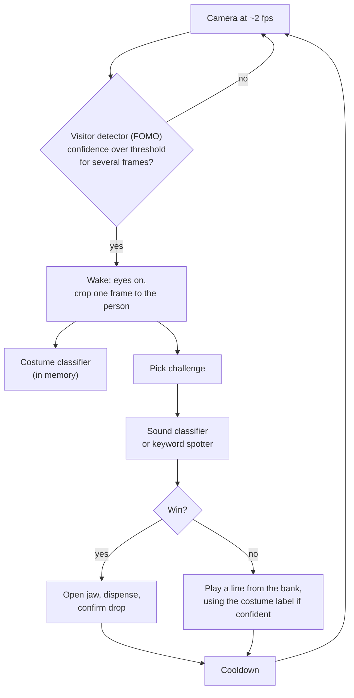

# Architecture

## Overview

Feed the Gargoyle splits work across both processors of the Arduino UNO Q. The Linux MPU (Qualcomm QRB2210) runs the models and the game logic. The STM32U585 MCU runs everything that must be real-time or safe. The two talk over the App Lab Bridge.

| Concern | Runs on | Reason |
|---|---|---|
| Visitor detection, sound classification, keyword spotting, costume classification | MPU | Needs Linux, the camera and the microphone |
| Game state machine, line selection, audio playback | MPU | Simple logic, easy to test |
| Line bank generation (Gemma 3 1B) and speech rendering (Piper) | MPU, while idle | Too slow to run during play |
| Spine bar, eye panels, jaw servo, candy wheel, drop sensor | MCU | Real-time output; must not depend on Linux timing |
| Safety state and watchdog | MCU | Must work when the MPU hangs |

## Model cascade

The detector is cheap and always on. The sound and keyword models run only while a visitor is present. The costume classifier runs once per visit, on a crop of the person, and the language model never runs during a visit.

## Game states

| State | What happens | Starting values (to tune) |
|---|---|---|
| IDLE | Eyes dim, slow glow. Visitor detector only. | ~2 fps |
| WAKE | Visitor confirmed. Eyes open. One cropped frame goes to the costume classifier. | confidence at least 0.6 on 3 consecutive frames |
| CHALLENGE | Pick a sound challenge or a riddle at random and announce it. | |
| LISTEN | Sound classifier streams, or keyword spotter waits for an answer. Spine bar follows the score. | 1 s windows, 250 ms stride, average of 2 to 3 windows; 8 to 10 s limit |
| RESULT | Win: jaw opens, wheel dispenses, drop sensor confirms. Fail: play a line from the bank. | one retry if no drop is detected |
| COOLDOWN | Ignore new input, forget the visitor. | about 10 s; release after about 5 s with no visitor |

The sound threshold comes from Edge Impulse Performance Calibration and is confirmed on a long recording, not chosen by hand.

## Line bank

Gemma 3 1B writes lines ahead of time, keyed by situation (too quiet, wrong sound, wrong answer, timeout) and by costume label. Each line passes a validator before it is kept:

- length limit in words;
- no reference to a person's face, body, age or ethnicity;
- no banned terms, and suitable for children;
- a retry with a fresh sample on failure.

Accepted lines are rendered to audio with Piper and stored with their text. During play the game only selects a line. Generation runs while no visitor is present and is paused the moment one is detected, so it cannot starve the audio models. If the bank has no suitable line, the game falls back to a small hand-written set.

## Bridge contract (provisional)

| Direction | Message | Purpose |
|---|---|---|
| MPU to MCU | `set_mode(idle, listen, win, fail)` | Eye and bar animation |
| MPU to MCU | `set_level(0 to 100)` | Spine bar fill |
| MPU to MCU | `dispense()` | Open jaw and run the wheel |
| MPU to MCU | `heartbeat()` | Liveness |
| MCU to MPU | `drop_confirmed()` | Break-beam saw a candy |
| MCU to MPU | `jam()` | No drop after the retry |

The first sketch implements `set_mode`, `dispense`, `heartbeat`, `drop_confirmed` and `jam`; `set_level` waits for the spine bar. Pins, servo angles and wheel steps in the sketch are placeholders to calibrate on the build. The MCU sends its notices from `loop()`, not from a handler. Handlers on the MCU must not block, and LED refresh must not run on every loop pass (see operating constraints).

## Safe state

The MCU enters a safe state (jaw closed, wheel stopped, bar showing idle glow) when:

- no heartbeat arrives for 1000 ms (starting value);
- a dispense fails twice in a row;
- a Bridge call fails repeatedly.

The safe state is cleared only by a fresh heartbeat and an explicit `set_mode(idle)` from the MPU.

## Failure behaviour

| Failure | Behaviour |
|---|---|
| MPU stalls or reboots | Watchdog moves the MCU to the safe state |
| Microphone missing | Game stays in IDLE |
| Camera missing | Game runs without the visitor gate and without costume lines |
| Candy jam | Retry once, then safe state and an error pattern on the bar |
| Language model unavailable or slow | Hand-written fallback lines |

## Operating constraints

These come from earlier projects on UNO Q boards and must be re-measured for this build.

- **Language model threads.** On a 4 GB board, llama.cpp ran with `-t 3 -c 2048 --cache-reuse 256`. Four threads reset the board twice under full load, and the cause was traced to the SoC core rail, not the supply, thermals, memory or the watchdog.
- **Language model speed under full load (Gemma 3 1B, 4 GB board).** Prompt processing 5.4 to 6.5 tokens/s, generation 2.27 to 2.50 tokens/s, time to first token 19.1 to 23.1 s (median 20.9 s). A byte-identical prompt hit the cache and returned the first token in 1.2 to 1.8 s. This is why lines are generated ahead of time.
- **Language model speed on a 2 GB board (Gemma 3 1B, App Lab runner).** 9.3 to 10.4 tokens/s prompt, 4.7 to 5.1 tokens/s generation, median 28.0 s per command over 185 to 214 prompt tokens.
- **Speech.** Piper took about 0.5 s of synthesis per second of speech (0.74 to 1.42 s for 1.4 to 2.7 s of audio).
- **Bridge and LEDs.** Redrawing an LED ring every 40 ms made every Bridge call time out. Redrawing only on state change gave 6 to 8 ms per call. The spine bar and both eye panels have more pixels than that ring, so redraw on change or at a low fixed rate and measure Bridge latency with the LEDs running.
- **Microphone level.** At full gain a close-range voice clipped at 32,767 and speech recognition degraded. Screams at close range will clip the same way, so fix the gain, record training data with the final microphone and gain, and check peak levels.
- **Power.** A weak supply tolerated the board alone but boot-looped once a peripheral was added. Use a proper USB-C PD supply for the board and a separate 5 V rail for LEDs, servo and stepper, with a shared ground.

## Privacy

Frames are held in memory only long enough to classify them. Nothing is written to disk during play, and no network calls are made at runtime. Training data comes from adult volunteers who gave written consent (see [data collection](data-collection.md)).
